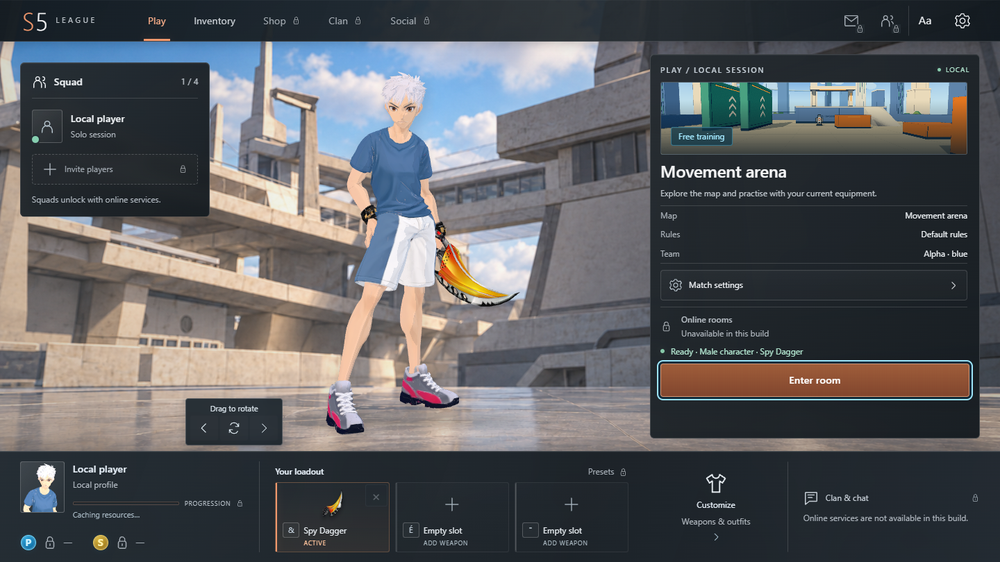
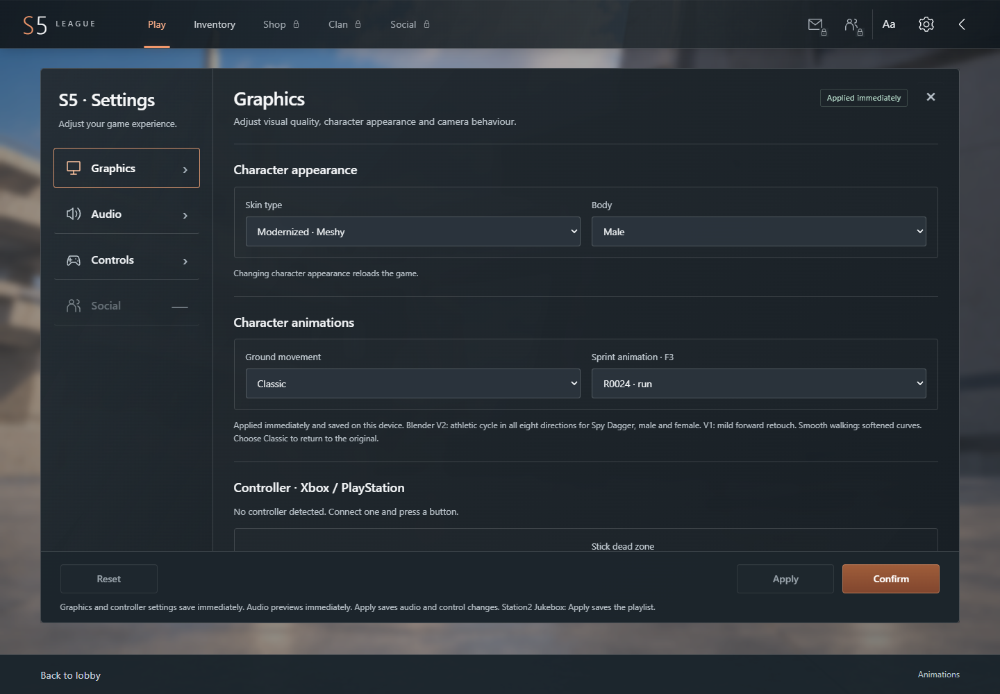
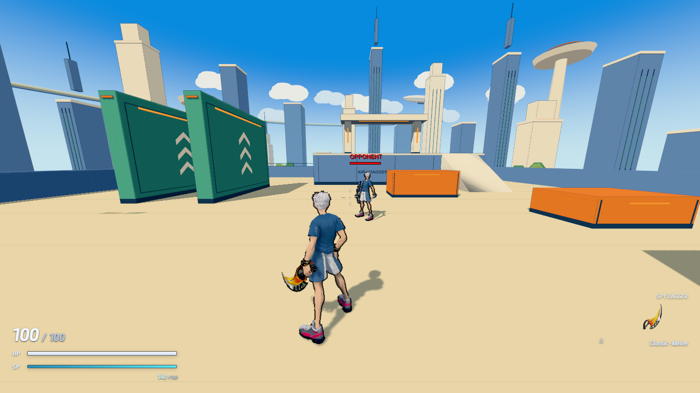

<div align="center">

# S5 League

**An experimental third-person action game, built for the browser with Three.js.**

[**Play in your browser**](https://s5-league.s5league.workers.dev) · [**Download the release**](https://github.com/Clarity-1/S5-League/releases/latest) · [**Developer guide**](DEVELOPER-GUIDE.md)



*An actual screenshot of the current browser build.*

</div>

S5 League is an **unofficial browser game project exploring S4-style third-person
action**. It brings movement, melee and ranged weapons, characters, and maps into
a readable Three.js implementation. Development combines gameplay code, imported
resources, and reference data.

**The game rules are based on Xero.**

The aim is to make the game easy to try and its implementation easy to study:
explore a local arena, try equipment, inspect attack timings, or change movement
and collision behavior in JavaScript. Reproducing a reference behavior requires
checking physics, input handling, timing, animation, and contact together. That
work is ongoing; this release does not claim complete one-to-one fidelity.

The game runs on your computer. The website serves the game files and assets;
your browser executes the game. No account is required to try the current build.

[Start playing](#your-first-session) · [Settings](#where-to-find-the-settings) ·
[Developer packet](#the-developer-packet) · [File map](#repository-layout) ·
[Remaining work](#what-remains-to-be-done)

## Play, download, or develop

| What you want | Where to go |
| --- | --- |
| Play immediately | [Launch the web version](https://s5-league.s5league.workers.dev) |
| Run the current compiled build yourself | [Download **S5-browser-build.zip**](https://github.com/Clarity-1/S5-League/releases/latest/download/S5-browser-build.zip) |
| Explore or modify the game | Clone this repository, or download [**S5-dev-packet-english.zip**](https://github.com/Clarity-1/S5-League/releases/latest/download/S5-dev-packet-english.zip) |
| Read the technical handoff | [Developer guide](DEVELOPER-GUIDE.md), [project map](PROJECT.md), [weapon guide](ARMES.md) |

The browser ZIP contains the compiled game and the resources it needs. The
developer ZIP contains editable sources and original runtime resources. Both
are separate downloads attached to the release. Large archives are kept out
of Git history.

## Your first session

1. Open [the web version](https://s5-league.s5league.workers.dev) in a modern
   desktop browser with WebGL2 enabled. Wait for loading to finish.
2. In **Play**, start with **Movement arena** and **Free training**. Use
   **Match settings** to choose an available mode, map, team, and match options.
   Available choices depend on the selected mode.
3. Open **Inventory**, **Customize**, or one of the weapon slots along the bottom
   to choose equipment. Keep at least one weapon equipped. Character appearance
   is available in **Settings → Graphics**.
4. Select **Enter room**, then **Start** in the local waiting room. This prepares
   a local session; it does not connect you to other players.
5. During play, press **Escape** to open the game menu. **Resume** returns to
   play; **Return to room** takes you back to the waiting room. Use the room's
   leave/back controls to return to the lobby, then open Settings as needed.

| Action | Default keyboard / mouse input |
| --- | --- |
| Move | Physical W / A / S / D positions; Z / Q / S / D labels on AZERTY |
| Jump / contextual dodge | Space; the result depends on movement state |
| Sprint | Double-tap forward |
| Primary / secondary attack | Left / right mouse button; behavior depends on the weapon |
| Look around | Move the mouse when captured; middle-button drag is the fallback |
| Reload a firearm | R |
| Select equipped weapon | Physical number-row slots 1 / 2 / 3; displayed labels follow your keyboard |
| Game menu | Escape |

Use **Settings → Controls** as the authoritative view of your current bindings.
Saved bindings can differ from the defaults. Some reference commands appear in
the interface without a complete gameplay implementation.

## Where to find the settings

Click the **gear icon in the top-right corner of the lobby**. Settings has a
scrollable content area; scroll inside it to see the lower options.

| Section | What you can inspect or change |
| --- | --- |
| **Graphics** | Character skin/body, locomotion and sprint animation variants, controller preferences, outlines, render quality, shadows, camera modes, dodge effects, weapon picker, HP/SP scale, Infinite SP, and weapon aura options |
| **Audio** | Effect volume, background music, mute, and the Station 2 playlist |
| **Controls** | Keyboard bindings and mouse preferences; use the Keyboard/Mouse subpanels |
| **Social** | Unavailable in this build |

Graphics and controller changes save immediately on the current device. Audio
previews immediately; **Apply** saves audio and control changes, and the Station 2
playlist. **Confirm** saves and closes the panel. Changing character appearance
reloads the game. These are local browser preferences, not an online account.



For slower hardware, try **Performance**, disable shadows, and reduce outlines.
Performance depends on your browser, GPU, map, and chosen effects; no fixed frame
rate is promised.

## What is available today

- **Movement and physics:** jumping, dashes, locomotion, action transitions, and
  training controls.
- **Combat systems:** melee and ranged weapon implementations, attack windows,
  impact timing, recovery, effects, and a local training opponent.
- **Collisions:** world queries, character movement, attack volumes, and map geometry.
- **Characters and worlds:** animation playback, equipment attachments, imported
  maps, and browser interfaces. This snapshot includes updated resources for
  Bio Lab, Blade City, and Iron Heart.

Local sessions are available. Weapon, map, and mode integration varies; a visible
option does not establish complete behavior. Online rooms, squads, shop, clan,
chat, currencies, and progression services are not connected in this release.



## What this project is not

- **Not an official S4 League client, release, or online service.**
- **Not a finished replacement for the reference game.** A loaded asset or a
  visible animation does not establish matching damage, movement, or collision.
- **Not a working public multiplayer server.** A local waiting room and local
  opponents do not provide matchmaking or network play. Locked account-service
  controls do not imply functioning online systems.
- **Not a video stream or cloud gaming session.** Your browser executes the game.
- **Not the complete research workspace.** Native installations, research
  corpora, authoring files, historical builds, and the full research-dependent
  test suite are outside this portable release.

## What remains to be done

These are development areas, not promises of a delivery date:

| Area | Remaining work |
| --- | --- |
| Movement and physics | Continue validating integration, input transitions, jumping, dashes, energy behavior, and reproducibility against reference evidence |
| Weapons and combat | Check each weapon's input windows, charge/release behavior, damage timing, recovery, hit volumes, effects, and male/female animation attachment |
| Maps and collisions | Verify imported geometry, collision surfaces, spawns, map-specific rules, and visual consistency beyond the tested paths |
| Game modes | Validate complete local match lifecycles and mode-specific rules; availability in a menu is not proof of completeness |
| Online services | Design and implement networking, authoritative match state, rooms/invitations, accounts, and connected social/progression services |
| Performance and usability | Profile on real hardware, improve resource loading and memory use, and broaden browser, controller, and touch-device coverage |
| Developer handoff | Expand portable tests and reproducible import tooling, improve English technical documentation, and resolve documented warnings |

Current known issues include the documented Conquest export warning and a
missing source texture, `/assets/vital_shock_n.dds`. Existing smoke checks cover
selected paths and do not establish exhaustive gameplay correctness.

## A few extra things to explore

- Alternative character appearances and experimental locomotion variants, with
  **Classic** available in the animation choices.
- Normal, cinematic, free, and cinematic free cameras; outline and dodge-effect styles.
- Training conveniences such as **Infinite SP** (**F4**) and sprint-style cycling
  (**F3**). **F2** opens the animation workshop when the character/session is ready.
- Xbox / PlayStation controller settings and a button guide under **Graphics**.
  Hardware coverage is still a work in progress.
- The **Aa** button in the lobby changes interface text size.
- Developer pages such as [weapon fitting](weapon-fitting.html),
  [animation workshop](animation-workshop.html), and
  [locomotion comparison](locomotion-compare.html), served from a local source run.
  These are tools and experiments, not a promise of finished gameplay features.

## The developer packet

**The developer packet is the editable project, not just the playable build.**
It is available as [S5-dev-packet-english.zip](https://github.com/Clarity-1/S5-League/releases/latest/download/S5-dev-packet-english.zip)
in the release: **4,430 files**, approximately **921 MB compressed** and **1.37 GB
unpacked**, before installing dependencies. The repository and developer ZIP contain the same portable source snapshot,
including the introduction and screenshots.

Included are JavaScript sources, original runtime assets, technical notes, eight
HTML entry points, locked npm dependencies, Vite configuration, and the two
required helpers. `node_modules` is not bundled; run `npm ci` first.

This is where to work on **physics, weapon timings, collisions, animations, maps,
effects, and UI**. The compiled browser ZIP is intended for playing or static
hosting; it is not a substitute for these editable sources.

Read [DEVELOPER-GUIDE.md](DEVELOPER-GUIDE.md), [AGENTS.md](AGENTS.md),
[ARMES.md](ARMES.md), and [PROJECT.md](PROJECT.md). Each packet has a SHA256 file
manifest, and release downloads include checksums. Preserve original resource
names and the distinction between source provenance and generated output.

## Repository layout

| Location | Files in this source snapshot | Purpose |
| --- | ---: | --- |
| [`src/`](src) | 1,257 | Gameplay, physics, collision, weapon data, animation, maps, rendering, and UI |
| [`public/assets/`](public/assets) | 3,043 | Original runtime resources: models, textures, animation/data exports, audio, and interface assets |
| [`docs/`](docs) | 107 | Technical contracts, per-weapon/import notes, historical documents, and three presentation screenshots |
| [`tools/`](tools) | 2 | Distribution cleanup and attack-volume intersection helpers |
| Root files | 21 | Eight HTML entry points, package/config files, English guides, validation record, and manifest |

Most disk space is in assets, not JavaScript. The compiled distribution contains
**2,884 site files** after bundling and export processing; its structure and file
count differ from the editable source packet. ZIPs are release assets, not
duplicated inside this tree. [FILE-MANIFEST.json](FILE-MANIFEST.json) lists the
exact paths, sizes, and SHA256 digests of this repository snapshot.

## Run from source

Use **Node.js 22.20.0** (see [.nvmrc](.nvmrc)).

```sh
git clone https://github.com/Clarity-1/S5-League.git
cd S5-League
npm ci
npm run dev
```

Open the local URL printed by Vite. To create and preview a production build:

```sh
npm run build
npm run preview
```

Runtime assets are included as real files in `public/assets/`, without Git LFS.
Allow roughly **1.4 GB** for the source checkout before dependencies and generated
output. The initial npm installation needs Internet access. Assets load according
to the selected map and equipment; the total package size is not the initial
menu download size.

For the compiled ZIP, extract it and serve `site/` over HTTP. For example, with
Python installed, run this from the extracted directory:

```sh
python -m http.server 8080 --directory site
```

Open `http://localhost:8080`. See the English README inside the ZIP for hosting
instructions. The browser build can be hosted as static files.

## Find the implementation

| System | Entry points |
| --- | --- |
| Startup | [bootstrap.js](src/bootstrap.js), [main.js](src/main.js) |
| Movement physics | [controller.js](src/controller.js), [movement-profile.js](src/movement-profile.js), [motion-graph.js](src/motion-graph.js) |
| Reference physics parameters | [s5runtime-physics-data.js](src/s5runtime-physics-data.js), [s5runtime-native-physics-data.js](src/s5runtime-native-physics-data.js) |
| Collisions | [collision.js](src/collision.js), `src/native-collision-*.js`, [native-melee.js](src/native-melee.js) |
| Attack intersections | [attack-box-intersection.mjs](tools/s5runtime-arsenal/attack-box-intersection.mjs) |
| Weapon timings and behavior | [spy-dagger-timing.js](src/spy-dagger-timing.js), `src/*-combat-data.js`, [weapon guide](ARMES.md) |
| Loadouts and equipment | [loadout.js](src/loadout.js), [weapon-inventory.js](src/weapon-inventory.js), [avatar.js](src/avatar.js) |
| Maps and assets | [imported-map.js](src/imported-map.js), `src/*-world.js`, [public/assets](public/assets) |

Follow each module's imports for the complete behavior. Input windows, animation
duration, damage timing, and recovery can be controlled by different modules.

## Contributing and validation

Start with [DEVELOPER-GUIDE.md](DEVELOPER-GUIDE.md) and [AGENTS.md](AGENTS.md).
Keep changes focused and explain how you checked them. Preserve resource names
and provenance checks when changing imported content.

This portable source edition normalizes internal file names, resource paths,
and matching integrity records. It keeps authored provenance distinct from the
bytes of transformed resources. See [VALIDATION.json](VALIDATION.json) for the
fresh installation, build, browser checks, and documented Conquest warning.
The complete research-dependent test suite remains outside this packet.

The public entry guides are in English. Existing source comments and historical
research notes retain their original language; historical guides with normalized internal names are archived under
[docs/source-history](docs/source-history).
